<!--
  Gerado por scripts/gerar-svgs.mjs (node scripts/gerar-svgs.mjs) — edite os
  textos lá, não aqui: o script reescreve este arquivo e todos os SVGs de
  assets/ (desktop e celular, tema claro e escuro). As capturas dos projetos
  ficam em assets/shots/ e vão embutidas nos cartões. A cobrinha e o gráfico
  3D das contribuições são gerados todo dia por .github/workflows/snake.yml e
  publicados no branch `output`.
-->

<picture>
  <source media="(max-width: 600px) and (prefers-color-scheme: dark)" srcset="assets/hero-mobile-dark.svg">
  <source media="(max-width: 600px) and (prefers-color-scheme: light)" srcset="assets/hero-mobile-light.svg">
  <source media="(max-width: 600px)" srcset="assets/hero-mobile-dark.svg">
  <source media="(prefers-color-scheme: dark)" srcset="assets/hero-dark.svg">
  <source media="(prefers-color-scheme: light)" srcset="assets/hero-light.svg">
  
</picture>

  <a href="https://linkedin.com/in/dev-murilo-de-souza"><picture><source media="(prefers-color-scheme: light)" srcset="assets/btn-linkedin-light.svg"></picture></a>
  <a href="mailto:murilocerqueira361@gmail.com"><picture><source media="(prefers-color-scheme: light)" srcset="assets/btn-email-light.svg"></picture></a>
  <a href="#projetos"><picture><source media="(prefers-color-scheme: light)" srcset="assets/btn-projetos-light.svg"></picture></a>
  <a href="https://www.google.com/maps/place/Cama%C3%A7ari,+BA"><picture><source media="(prefers-color-scheme: light)" srcset="assets/btn-local-light.svg"></picture></a>

  
  
  

 

<picture>
  <source media="(max-width: 600px) and (prefers-color-scheme: dark)" srcset="assets/title-sobre-mobile-dark.svg">
  <source media="(max-width: 600px) and (prefers-color-scheme: light)" srcset="assets/title-sobre-mobile-light.svg">
  <source media="(max-width: 600px)" srcset="assets/title-sobre-mobile-dark.svg">
  <source media="(prefers-color-scheme: dark)" srcset="assets/title-sobre-dark.svg">
  <source media="(prefers-color-scheme: light)" srcset="assets/title-sobre-light.svg">
  
</picture>

<picture>
  <source media="(max-width: 600px) and (prefers-color-scheme: dark)" srcset="assets/about-mobile-dark.svg">
  <source media="(max-width: 600px) and (prefers-color-scheme: light)" srcset="assets/about-mobile-light.svg">
  <source media="(max-width: 600px)" srcset="assets/about-mobile-dark.svg">
  <source media="(prefers-color-scheme: dark)" srcset="assets/about-dark.svg">
  <source media="(prefers-color-scheme: light)" srcset="assets/about-light.svg">
  
</picture>

Desenvolvedor full-stack e profissional de dados, atuando na interseção entre **desenvolvimento de software**, **BI/automação de processos** e **ambiente industrial**. Hoje na **ENGENOVA Construções**, numa unidade dentro da fábrica da **BYD** em Camaçari/BA, transformando dados de operação em decisão — e construindo as ferramentas que faltam quando a ideal não está disponível.

 

<picture>
  <source media="(max-width: 600px) and (prefers-color-scheme: dark)" srcset="assets/title-servicos-mobile-dark.svg">
  <source media="(max-width: 600px) and (prefers-color-scheme: light)" srcset="assets/title-servicos-mobile-light.svg">
  <source media="(max-width: 600px)" srcset="assets/title-servicos-mobile-dark.svg">
  <source media="(prefers-color-scheme: dark)" srcset="assets/title-servicos-dark.svg">
  <source media="(prefers-color-scheme: light)" srcset="assets/title-servicos-light.svg">
  
</picture>

<picture>
  <source media="(max-width: 600px) and (prefers-color-scheme: dark)" srcset="assets/services-mobile-dark.svg">
  <source media="(max-width: 600px) and (prefers-color-scheme: light)" srcset="assets/services-mobile-light.svg">
  <source media="(max-width: 600px)" srcset="assets/services-mobile-dark.svg">
  <source media="(prefers-color-scheme: dark)" srcset="assets/services-dark.svg">
  <source media="(prefers-color-scheme: light)" srcset="assets/services-light.svg">
  
</picture>

 

<picture>
  <source media="(max-width: 600px) and (prefers-color-scheme: dark)" srcset="assets/title-stack-mobile-dark.svg">
  <source media="(max-width: 600px) and (prefers-color-scheme: light)" srcset="assets/title-stack-mobile-light.svg">
  <source media="(max-width: 600px)" srcset="assets/title-stack-mobile-dark.svg">
  <source media="(prefers-color-scheme: dark)" srcset="assets/title-stack-dark.svg">
  <source media="(prefers-color-scheme: light)" srcset="assets/title-stack-light.svg">
  
</picture>

<picture>
  <source media="(max-width: 600px) and (prefers-color-scheme: dark)" srcset="assets/stack-mobile-dark.svg">
  <source media="(max-width: 600px) and (prefers-color-scheme: light)" srcset="assets/stack-mobile-light.svg">
  <source media="(max-width: 600px)" srcset="assets/stack-mobile-dark.svg">
  <source media="(prefers-color-scheme: dark)" srcset="assets/stack-dark.svg">
  <source media="(prefers-color-scheme: light)" srcset="assets/stack-light.svg">
  
</picture>

 

<picture>
  <source media="(max-width: 600px) and (prefers-color-scheme: dark)" srcset="assets/title-projetos-mobile-dark.svg">
  <source media="(max-width: 600px) and (prefers-color-scheme: light)" srcset="assets/title-projetos-mobile-light.svg">
  <source media="(max-width: 600px)" srcset="assets/title-projetos-mobile-dark.svg">
  <source media="(prefers-color-scheme: dark)" srcset="assets/title-projetos-dark.svg">
  <source media="(prefers-color-scheme: light)" srcset="assets/title-projetos-light.svg">
  
</picture>

<a href="https://github.com/mdevsec-code/falcao-saude-ocupacional">
<picture>
  <source media="(max-width: 600px) and (prefers-color-scheme: dark)" srcset="assets/project-saude-mobile-dark.svg">
  <source media="(max-width: 600px) and (prefers-color-scheme: light)" srcset="assets/project-saude-mobile-light.svg">
  <source media="(max-width: 600px)" srcset="assets/project-saude-mobile-dark.svg">
  <source media="(prefers-color-scheme: dark)" srcset="assets/project-saude-dark.svg">
  <source media="(prefers-color-scheme: light)" srcset="assets/project-saude-light.svg">
  
</picture>
</a>

<a href="https://github.com/mdevsec-code/falcao-saude-ocupacional"><b>Falcão Saúde Ocupacional</b> · repositório</a> · <a href="https://falcao-saude-ocupacional-eta.vercel.app">🌐 demonstração no ar</a>

<a href="https://github.com/mdevsec-code/Falcao-RH-Management">
<picture>
  <source media="(max-width: 600px) and (prefers-color-scheme: dark)" srcset="assets/project-rh-mobile-dark.svg">
  <source media="(max-width: 600px) and (prefers-color-scheme: light)" srcset="assets/project-rh-mobile-light.svg">
  <source media="(max-width: 600px)" srcset="assets/project-rh-mobile-dark.svg">
  <source media="(prefers-color-scheme: dark)" srcset="assets/project-rh-dark.svg">
  <source media="(prefers-color-scheme: light)" srcset="assets/project-rh-light.svg">
  
</picture>
</a>

<a href="https://github.com/mdevsec-code/Falcao-RH-Management"><b>Falcão RH</b> · repositório</a>

<a href="https://github.com/mdevsec-code/falcao-ERP-suprimentos-master">
<picture>
  <source media="(max-width: 600px) and (prefers-color-scheme: dark)" srcset="assets/project-erp-mobile-dark.svg">
  <source media="(max-width: 600px) and (prefers-color-scheme: light)" srcset="assets/project-erp-mobile-light.svg">
  <source media="(max-width: 600px)" srcset="assets/project-erp-mobile-dark.svg">
  <source media="(prefers-color-scheme: dark)" srcset="assets/project-erp-dark.svg">
  <source media="(prefers-color-scheme: light)" srcset="assets/project-erp-light.svg">
  
</picture>
</a>

<a href="https://github.com/mdevsec-code/falcao-ERP-suprimentos-master"><b>Falcão ERP Suprimentos</b> · repositório</a>

<a href="https://github.com/mdevsec-code/clinica-de-saude-estetica">
<picture>
  <source media="(max-width: 600px) and (prefers-color-scheme: dark)" srcset="assets/project-clinica-mobile-dark.svg">
  <source media="(max-width: 600px) and (prefers-color-scheme: light)" srcset="assets/project-clinica-mobile-light.svg">
  <source media="(max-width: 600px)" srcset="assets/project-clinica-mobile-dark.svg">
  <source media="(prefers-color-scheme: dark)" srcset="assets/project-clinica-dark.svg">
  <source media="(prefers-color-scheme: light)" srcset="assets/project-clinica-light.svg">
  
</picture>
</a>

<a href="https://github.com/mdevsec-code/clinica-de-saude-estetica"><b>Clínica Noely Cerqueira</b> · repositório</a>

<a href="https://github.com/mdevsec-code/Controle-de-EPI">
<picture>
  <source media="(max-width: 600px) and (prefers-color-scheme: dark)" srcset="assets/project-epi-mobile-dark.svg">
  <source media="(max-width: 600px) and (prefers-color-scheme: light)" srcset="assets/project-epi-mobile-light.svg">
  <source media="(max-width: 600px)" srcset="assets/project-epi-mobile-dark.svg">
  <source media="(prefers-color-scheme: dark)" srcset="assets/project-epi-dark.svg">
  <source media="(prefers-color-scheme: light)" srcset="assets/project-epi-light.svg">
  
</picture>
</a>

<a href="https://github.com/mdevsec-code/Controle-de-EPI"><b>Controle de Entrega de EPIs</b> · repositório</a>

<a href="https://github.com/mdevsec-code/seminario-bsc-governanca-ti">
<picture>
  <source media="(max-width: 600px) and (prefers-color-scheme: dark)" srcset="assets/project-seminario-mobile-dark.svg">
  <source media="(max-width: 600px) and (prefers-color-scheme: light)" srcset="assets/project-seminario-mobile-light.svg">
  <source media="(max-width: 600px)" srcset="assets/project-seminario-mobile-dark.svg">
  <source media="(prefers-color-scheme: dark)" srcset="assets/project-seminario-dark.svg">
  <source media="(prefers-color-scheme: light)" srcset="assets/project-seminario-light.svg">
  
</picture>
</a>

<a href="https://github.com/mdevsec-code/seminario-bsc-governanca-ti"><b>Seminário BSC na Governança de TI</b> · repositório</a> · <a href="https://mdevsec-code.github.io/seminario-bsc-governanca-ti/">🌐 abrir o site</a>

 

<picture>
  <source media="(max-width: 600px) and (prefers-color-scheme: dark)" srcset="assets/title-atividade-mobile-dark.svg">
  <source media="(max-width: 600px) and (prefers-color-scheme: light)" srcset="assets/title-atividade-mobile-light.svg">
  <source media="(max-width: 600px)" srcset="assets/title-atividade-mobile-dark.svg">
  <source media="(prefers-color-scheme: dark)" srcset="assets/title-atividade-dark.svg">
  <source media="(prefers-color-scheme: light)" srcset="assets/title-atividade-light.svg">
  
</picture>

<picture>
  <source media="(prefers-color-scheme: dark)" srcset="https://raw.githubusercontent.com/mdevsec-code/mdevsec-code/output/3d/profile-night-rainbow.svg">
  <source media="(prefers-color-scheme: light)" srcset="https://raw.githubusercontent.com/mdevsec-code/mdevsec-code/output/3d/profile-season-animate.svg">
  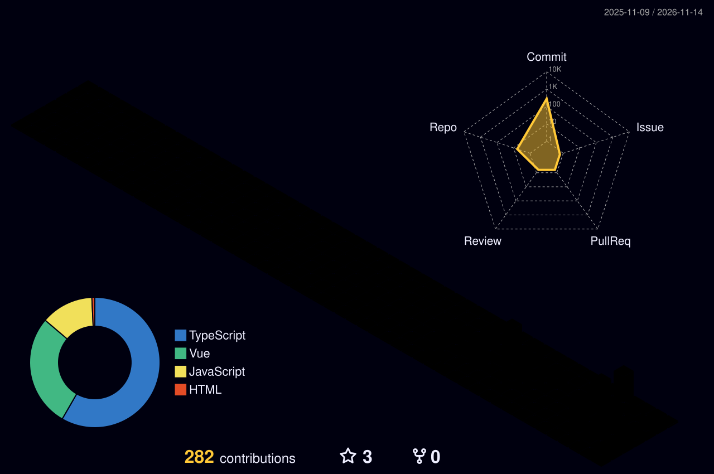
</picture>

<picture>
  <source media="(prefers-color-scheme: dark)" srcset="https://raw.githubusercontent.com/mdevsec-code/mdevsec-code/output/github-snake-dark.svg">
  <source media="(prefers-color-scheme: light)" srcset="https://raw.githubusercontent.com/mdevsec-code/mdevsec-code/output/github-snake.svg">
  
</picture>

  <picture>
    <source media="(prefers-color-scheme: dark)" srcset="https://streak-stats.demolab.com?user=mdevsec-code&locale=pt_BR&hide_border=true&background=00000000&ring=22D3EE&fire=F472B6&currStreakNum=EEF2FF&sideNums=8B5CF6&currStreakLabel=22D3EE&sideLabels=EEF2FF&dates=8C96BA&stroke=2A3A66">
    <source media="(prefers-color-scheme: light)" srcset="https://streak-stats.demolab.com?user=mdevsec-code&locale=pt_BR&hide_border=true&background=00000000&ring=0891B2&fire=DB2777&currStreakNum=0B1022&sideNums=7C3AED&currStreakLabel=0891B2&sideLabels=0B1022&dates=566182&stroke=C6D0EC">
    
  </picture>

 

<picture>
  <source media="(max-width: 600px) and (prefers-color-scheme: dark)" srcset="assets/title-formacao-mobile-dark.svg">
  <source media="(max-width: 600px) and (prefers-color-scheme: light)" srcset="assets/title-formacao-mobile-light.svg">
  <source media="(max-width: 600px)" srcset="assets/title-formacao-mobile-dark.svg">
  <source media="(prefers-color-scheme: dark)" srcset="assets/title-formacao-dark.svg">
  <source media="(prefers-color-scheme: light)" srcset="assets/title-formacao-light.svg">
  
</picture>

<picture>
  <source media="(max-width: 600px) and (prefers-color-scheme: dark)" srcset="assets/education-mobile-dark.svg">
  <source media="(max-width: 600px) and (prefers-color-scheme: light)" srcset="assets/education-mobile-light.svg">
  <source media="(max-width: 600px)" srcset="assets/education-mobile-dark.svg">
  <source media="(prefers-color-scheme: dark)" srcset="assets/education-dark.svg">
  <source media="(prefers-color-scheme: light)" srcset="assets/education-light.svg">
  
</picture>

  

<picture>
  <source media="(max-width: 600px) and (prefers-color-scheme: dark)" srcset="assets/footer-mobile-dark.svg">
  <source media="(max-width: 600px) and (prefers-color-scheme: light)" srcset="assets/footer-mobile-light.svg">
  <source media="(max-width: 600px)" srcset="assets/footer-mobile-dark.svg">
  <source media="(prefers-color-scheme: dark)" srcset="assets/footer-dark.svg">
  <source media="(prefers-color-scheme: light)" srcset="assets/footer-light.svg">
  
</picture>
