<!--
  Os SVGs animados (banner, botões, terminal, SAP, formação, divisórias e rodapé) ficam em
  assets/ e são gerados por scripts/gerar_svgs.py — edite os textos lá e rode o
  script. Banner e terminal têm versão de celular (*-mobile-*), escolhida pelo
  media="(max-width: 600px)". A cobrinha das contribuições é gerada todo dia por
  .github/workflows/snake.yml e publicada no branch `output`.
-->

<picture>
  <source media="(max-width: 600px) and (prefers-color-scheme: dark)" srcset="assets/header-mobile-dark.svg">
  <source media="(max-width: 600px) and (prefers-color-scheme: light)" srcset="assets/header-mobile-light.svg">
  <source media="(max-width: 600px)" srcset="assets/header-mobile-dark.svg">
  <source media="(prefers-color-scheme: dark)" srcset="assets/header-dark.svg">
  <source media="(prefers-color-scheme: light)" srcset="assets/header-light.svg">
  
</picture>

  <a href="https://linkedin.com/in/dev-murilo-de-souza"><picture><source media="(prefers-color-scheme: light)" srcset="assets/btn-linkedin-light.svg"></picture></a>
  <a href="mailto:murilocerqueira361@gmail.com"><picture><source media="(prefers-color-scheme: light)" srcset="assets/btn-email-light.svg"></picture></a>
  <a href="#-projetos-em-destaque"><picture><source media="(prefers-color-scheme: light)" srcset="assets/btn-projetos-light.svg"></picture></a>
  <a href="https://www.google.com/maps/place/Cama%C3%A7ari,+BA"><picture><source media="(prefers-color-scheme: light)" srcset="assets/btn-local-light.svg"></picture></a>

<picture>
  <source media="(prefers-color-scheme: dark)" srcset="assets/divider-dark.svg">
  <source media="(prefers-color-scheme: light)" srcset="assets/divider-light.svg">
  
</picture>

## 👋 Sobre mim

<picture>
  <source media="(max-width: 600px) and (prefers-color-scheme: dark)" srcset="assets/terminal-mobile-dark.svg">
  <source media="(max-width: 600px) and (prefers-color-scheme: light)" srcset="assets/terminal-mobile-light.svg">
  <source media="(max-width: 600px)" srcset="assets/terminal-mobile-dark.svg">
  <source media="(prefers-color-scheme: dark)" srcset="assets/terminal-dark.svg">
  <source media="(prefers-color-scheme: light)" srcset="assets/terminal-light.svg">
  
</picture>

Desenvolvedor full-stack e profissional de dados, atuando na interseção entre **desenvolvimento de software**, **BI/automação de processos** e **ambiente industrial**. Atualmente na **ENGENOVA Construções** (unidade nas instalações da fábrica da BYD, Camaçari/BA).

## 🔧 O que eu faço

- 🖥️ **Aplicações web** — sistemas full-stack de ponta a ponta com React, Vue, TypeScript, Node.js e NestJS: do banco à tela, com RBAC e auditoria.
- 📊 **Dashboards de BI** — ferramentas de BI personalizadas em HTML/JavaScript para cenários sem Power BI ou nuvem disponível.
- 🤖 **Automação** — relatórios e processos automatizados com Python, tirando o trabalho repetitivo do caminho.
- 🔗 **Integração com SAP** — integração e gestão de dados via SAP (Fiori, MM), ligando o ERP ao dia a dia da operação.
- 🏭 **Dados industriais** — consolidação, validação e análise de dados operacionais em ambiente de fábrica.
- 🦅 **Família Falcão** — Saúde Ocupacional e ERP de Suprimentos com a mesma stack e o mesmo design system, a caminho de um hub único.

## 🛠️ Stack

  <b>Front-end</b>  
  

  <b>Back-end e dados</b>  
  

  <b>Ferramentas e ERP</b>  
  
  <picture><source media="(prefers-color-scheme: light)" srcset="assets/sap-light.svg"></picture>

## 🚀 Projetos em destaque

### [🏥 Falcão Saúde Ocupacional](https://github.com/mdevsec-code/falcao-saude-ocupacional)

Plataforma de saúde e segurança ocupacional da Falcão Construções e Engenharia, para Recepção, Médicos, Enfermeiros, Técnicos de Segurança, RH e Administradores: agenda, **prontuário eletrônico**, atendimentos, CID, exames, **ASO por atividade de risco**, atestados, férias e **segurança do trabalho** (NBR 14280). 17 módulos, RBAC, **auditoria LGPD** e 3 idiomas.

      · [🔗 Demonstração no ar](https://falcao-saude-ocupacional-eta.vercel.app)

### [📦 Falcão ERP Suprimentos](https://github.com/mdevsec-code/falcao-ERP-suprimentos-master)

ERP do setor de Suprimentos da Falcão: fornecedores, produtos com histórico de preços, **compras com aprovação em etapas**, **contratos com aditivos**, **contas a pagar** com fluxo de caixa e conciliação de nota fiscal, reembolsos, documentos e agenda unificada. RBAC, auditoria, revisão de segurança e 3 idiomas.

     

### [💆‍♀️ Clínica Noely Cerqueira — Estética e Micropigmentação](https://github.com/mdevsec-code/clinica-de-saude-estetica)

Site público com **agendamento online self-service** e painel de gestão da clínica: catálogo, agenda, **acompanhamento de pacientes** (fichas clínicas, retornos automáticos, galeria antes/depois e lembretes via WhatsApp Cloud API), **financeiro** com DRE e conciliação bancária OFX, estoque e auditoria de acesso a dado sensível (LGPD). Base para um futuro SaaS multi-tenant.

      

### [🦺 Controle de Entrega de EPIs — ENGENOVA](https://github.com/mdevsec-code/Controle-de-EPI)

Entrega de EPIs com **assinatura do colaborador na tela** (QR Code do crachá, hash SHA-256 e comprovante), estoque por almoxarifado e local de armazenamento, validação de CA e auditoria completa — a rastreabilidade da NR-6, do celular do almoxarife ao computador da gestão.

    

## 📊 Atividade

<picture>
  <source media="(prefers-color-scheme: dark)" srcset="https://raw.githubusercontent.com/mdevsec-code/mdevsec-code/output/github-snake-dark.svg">
  <source media="(prefers-color-scheme: light)" srcset="https://raw.githubusercontent.com/mdevsec-code/mdevsec-code/output/github-snake.svg">
  
</picture>

<!-- streak-stats.demolab.com com as cores do banner (o tema pronto deixava
     "Maior sequência" e as datas com pouco contraste). -->

  <picture>
    <source media="(prefers-color-scheme: dark)" srcset="https://streak-stats.demolab.com?user=mdevsec-code&locale=pt_BR&hide_border=true&background=00000000&ring=2F81F7&fire=A371F7&currStreakNum=E6EDF3&sideNums=2F81F7&currStreakLabel=2F81F7&sideLabels=E6EDF3&dates=8B949E&stroke=30363D">
    <source media="(prefers-color-scheme: light)" srcset="https://streak-stats.demolab.com?user=mdevsec-code&locale=pt_BR&hide_border=true&background=00000000&ring=0969DA&fire=8250DF&currStreakNum=1F2328&sideNums=0969DA&currStreakLabel=0969DA&sideLabels=1F2328&dates=59636E&stroke=D0D7DE">
    
  </picture>

## 🎓 Formação e idiomas

<picture>
  <source media="(max-width: 600px) and (prefers-color-scheme: dark)" srcset="assets/formacao-mobile-dark.svg">
  <source media="(max-width: 600px) and (prefers-color-scheme: light)" srcset="assets/formacao-mobile-light.svg">
  <source media="(max-width: 600px)" srcset="assets/formacao-mobile-dark.svg">
  <source media="(prefers-color-scheme: dark)" srcset="assets/formacao-dark.svg">
  <source media="(prefers-color-scheme: light)" srcset="assets/formacao-light.svg">
  
</picture>

<picture>
  <source media="(max-width: 600px) and (prefers-color-scheme: dark)" srcset="assets/footer-mobile-dark.svg">
  <source media="(max-width: 600px) and (prefers-color-scheme: light)" srcset="assets/footer-mobile-light.svg">
  <source media="(max-width: 600px)" srcset="assets/footer-mobile-dark.svg">
  <source media="(prefers-color-scheme: dark)" srcset="assets/footer-dark.svg">
  <source media="(prefers-color-scheme: light)" srcset="assets/footer-light.svg">
  
</picture>
